[🇪🇸 Leer en español](README.es.md) · **🇺🇸 English**

### Management Information Systems Engineering Student · Data Analysis Enthusiast

Passionate about **turning data into decisions** and building technology solutions with real impact.

---

## 🧑‍💻 About Me

- 🎓 Management Information Systems Engineering Student at Universidad Tecnológica de Panamá
- 🎤 Shared my data analysis with Python knowledge at **TechHorizons Panamá 2025**
- 📊 Skilled with the **Microsoft Office suite**, including **Excel** and **Power BI**
- 💪 Comfortable with: **Python · HTML · C#**
- 🌱 Learning: **Java · Arduino**
- 🤝 Open to collaborating on **data-driven systems** and **software projects**

---

## 🛠️ Technologies & Tools

**Programming & Markup**

**Currently learning**

**Data & Microsoft tools**

**Design & development**

---

## 🏆 Experience

### 📊 Data Analysis with Python — TechHorizons Panamá 2025
Led sessions on data analysis using Python libraries such as **pandas**, helping participants learn to clean, explore and interpret data. This experience strengthened my communication, teaching and teamwork skills.

---

## 🎯 Areas of Interest

- 📊 Data analysis
- 🗂️ Information systems
- 📝 Software planning, design and development
- 🔌 Electronics and Arduino
- 🌐 Emerging technologies

---

## 📂 Featured Projects

| Project | Description | Technologies |
|---|---|---|
| [IlkaPoint-App](https://github.com/MasterFx04/IlkaPoint-App) | Management system built for the Ilca grocery store, designed to replace manual records and notebooks with a simple digital tool. | C# |
| [spacebirds-game-unity](https://github.com/MasterFx04/spacebirds-game-unity) | Angry Birds Space clone developed in Unity 2D as a team semester project. | C# · Unity |

---

## 🤝 Let's Connect

I'm open to learning, collaborating on technology projects and exploring new opportunities.

- 💼 LinkedIn: [Génesis Tenorio](génesis-tenorio-a52371316)
- 🐙 GitHub: [@LiethAlithT](https://github.com/LiethAlithT)

---

⭐ *Thanks for visiting my profile!* ⭐

